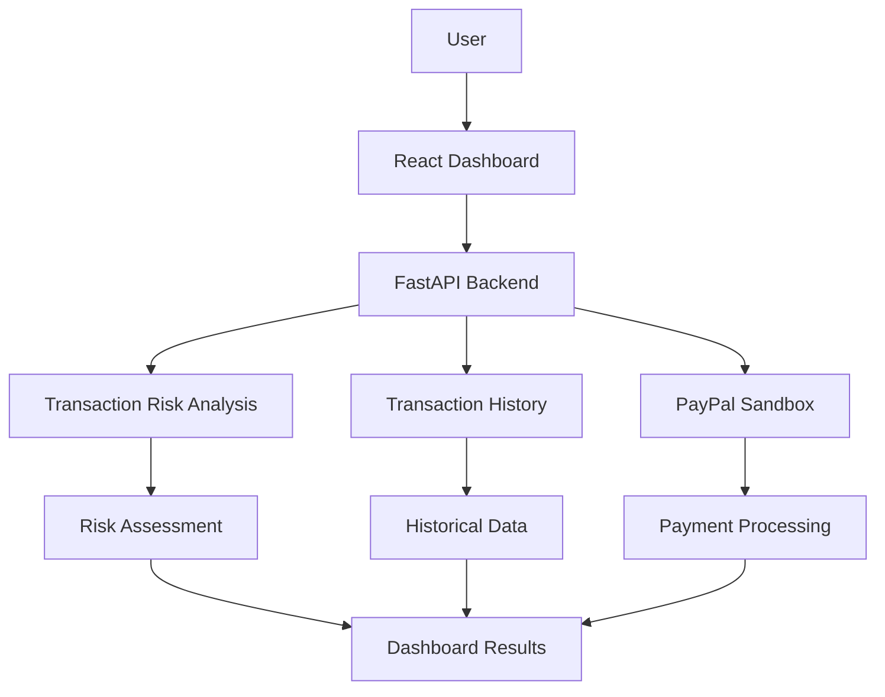

### Intelligent Payment Security & Fraud Risk Analysis Platform

<p align="center">
  <strong>Smarter Payment Protection. Intelligent Risk Analysis. Safer Transactions.</strong>
</p>

<p align="center">
  <a href="https://pay-shield-2xpbth7te-my-team-bb2a.vercel.app/">
    <strong>🚀 Live Demo</strong>
  </a>
  &nbsp; | &nbsp;
  <a href="https://github.com/Kunalkawale01/PayShield-AI">
    <strong>📂 Source Code</strong>
  </a>
  &nbsp; | &nbsp;
  <a href="https://payshield-ai-backend-7m14.onrender.com/docs">
    <strong>📘 API Documentation</strong>
  </a>
</p>

---

## 📌 Overview

**PayShield AI** is an intelligent payment security platform designed to analyze financial transactions, identify potentially suspicious activities, and provide transaction risk assessments.

The platform combines a modern React dashboard with a Python FastAPI backend and PayPal Sandbox integration to demonstrate an end-to-end payment security workflow.

It aims to make payment risk information easier to understand through transaction analysis, interactive visualizations, and historical transaction insights.

## ✨ Key Features

### 🔍 1. Transaction Risk Analysis
- Analyze transaction information.
- Evaluate transaction characteristics.
- Identify potentially suspicious payment activity.
- Generate risk assessment results.
- Display analysis results through an interactive dashboard.

### 📊 2. Interactive Security Dashboard
- Centralized transaction monitoring interface.
- Visual risk analytics and charts.
- Transaction insights and summaries.
- Easy-to-use interface for payment analysis.

### 📜 3. Transaction History
- Retrieve previously analyzed transactions.
- Review historical risk assessments.
- Track transaction analysis results.

### 💳 4. PayPal Sandbox Integration
- PayPal Sandbox payment gateway integration.
- Create payment orders through the backend.
- Capture payment orders.
- Test payment workflows without using real funds.

### ⚙️ 5. REST API Integration
- React frontend and FastAPI backend communication.
- Dedicated transaction analysis endpoints.
- Transaction history endpoints.
- PayPal payment endpoints.
- Backend health monitoring.
- Interactive Swagger API documentation.

---

## 🏗️ System Architecture



## 🔄 Application Workflow

1. The user enters transaction information.
2. The React frontend sends the data to the FastAPI backend.
3. The backend processes the transaction analysis request.
4. The risk-analysis logic evaluates transaction characteristics.
5. The backend generates a risk assessment.
6. The dashboard displays the results.
7. Users can review transaction history and test PayPal Sandbox payments.

---

## 🛠️ Technology Stack

| Component | Technology |
|---|---|
| Frontend | React.js |
| Build Tool | Vite |
| Programming Language | JavaScript |
| Styling | CSS |
| Data Visualization | Recharts |
| Icons | Lucide React |
| Backend | Python |
| Backend Framework | FastAPI |
| API Server | Uvicorn |
| Payment Gateway | PayPal Sandbox |
| API Communication | REST API, JSON |
| Frontend Deployment | Vercel |
| Backend Deployment | Render |
| Version Control | Git & GitHub |

---

## 📂 Project Structure

```text
PayShield-AI/
│
├── backend/
│   ├── main.py
│   ├── requirements.txt
│   └── ...
│
├── frontend/
│   ├── src/
│   │   └── App.jsx
│   ├── package.json
│   └── ...
│
├── .gitignore
└── README.md
```

---

## 🚀 Getting Started

Follow these steps to run PayShield AI locally.

### Prerequisites

- Python 3.11
- Node.js and npm
- Git
- PayPal Developer Account (for Sandbox testing)

### 1. Clone the Repository

```bash
git clone https://github.com/Kunalkawale01/PayShield-AI.git

cd PayShield-AI
```

### 2. Backend Setup

Navigate to the backend directory:

```bash
cd backend
```

Create a virtual environment:

```bash
python -m venv .venv
```

Activate it:

**Windows:**
```bash
.venv\Scripts\activate
```

**macOS / Linux:**
```bash
source .venv/bin/activate
```

Install dependencies:

```bash
pip install -r requirements.txt
```

Create a `.env` file inside the backend directory:

```env
PAYPAL_MODE=sandbox
PAYPAL_CLIENT_ID=your_sandbox_client_id
PAYPAL_CLIENT_SECRET=your_sandbox_client_secret
FRONTEND_ORIGINS=http://localhost:5173
```

Start the backend:

```bash
uvicorn main:app --reload
```

Backend URL:

```text
http://localhost:8000
```

### 3. Frontend Setup

Open a new terminal and navigate to the frontend directory:

```bash
cd frontend
```

Install dependencies:

```bash
npm install
```

Create a `.env.local` file:

```env
VITE_API_URL=http://localhost:8000
```

Start the frontend:

```bash
npm run dev
```

Open the application:

```text
http://localhost:5173
```

---

## 🔌 API Reference

| Method | Endpoint | Description |
|---|---|---|
| GET | `/api/health` | Backend health check |
| POST | `/api/analyze` | Analyze transaction risk |
| GET | `/api/history` | Retrieve transaction history |
| GET | `/api/paypal/config` | Retrieve PayPal configuration |
| POST | `/api/paypal/create-order` | Create PayPal payment order |
| POST | `/api/paypal/capture-order/{order_id}` | Capture PayPal payment |

**Interactive API Documentation:**

https://payshield-ai-backend-7m14.onrender.com/docs

---

## 🌐 Deployment

PayShield AI uses cloud-based deployment for its frontend and backend.

| Service | Platform |
|---|---|
| Frontend Application | Vercel |
| Backend API | Render |
| Payment Integration | PayPal Sandbox |
| Source Code | GitHub |

### Live Application

🚀https://pay-shield-ai-tan.vercel.app/ 

---

## 🔐 Security Considerations

- Store sensitive credentials in environment variables.
- Never expose PayPal Client Secrets in frontend code.
- Never commit `.env` files to the repository.
- Configure CORS for trusted frontend origins.
- Validate transaction inputs on the backend.
- Use PayPal Sandbox for payment testing.
- Implement rate limiting and monitoring before production deployment.

> **Disclaimer:** PayShield AI is a demonstration project. Its current risk-analysis logic is not a certified financial fraud detection system and should not be used as the sole basis for real financial decisions or payment authorization.

---

## 🔮 Future Enhancements

- Machine-learning-based fraud classification.
- Real-time transaction monitoring.
- Advanced anomaly detection.
- Explainable AI-based risk assessment.
- Device and behavioral analysis.
- Automated suspicious transaction alerts.
- Advanced analytics and reporting.
- User authentication and role-based access.
- Production-grade security and monitoring.

---

## 🎯 Project Objective

The objective of PayShield AI is to demonstrate how modern web technologies, transaction risk analysis, API integration, and payment gateway services can work together to build an intelligent payment security platform.

## 👨‍💻 Contributors

Developed as a technology project focused on payment security, transaction analysis, and fintech innovation.

---

<p align="center">
  <strong>🛡️ PayShield AI — Building a Safer Digital Payment Experience.</strong>
</p>
