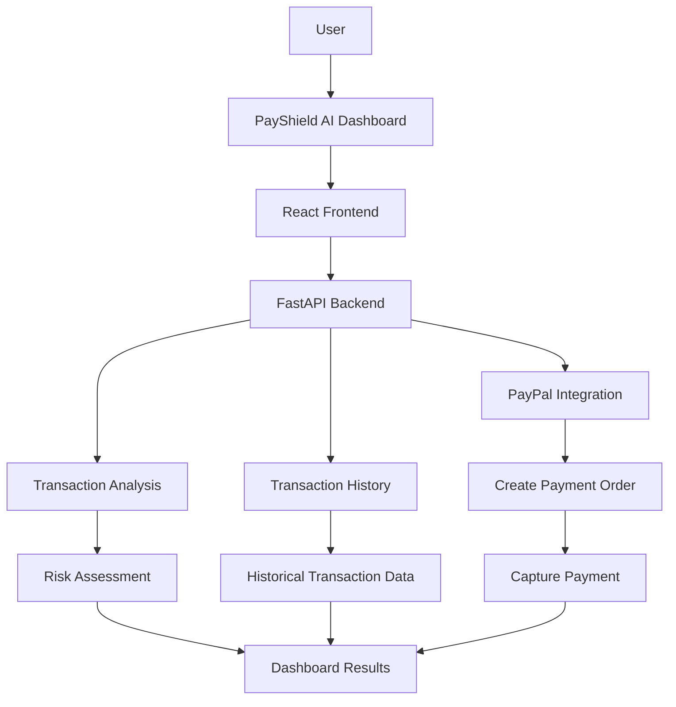
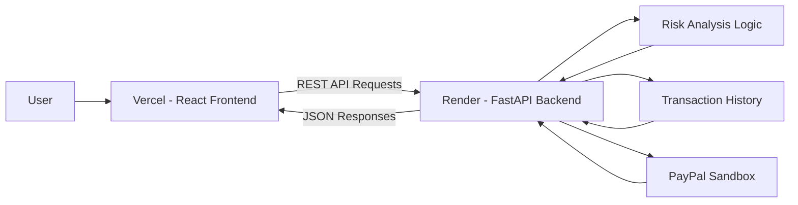

# PayShield AI
### Intelligent Payment Risk Analysis & Fraud Detection Platform

PayShield AI is a web-based payment security platform designed to analyze transactions, identify suspicious payment activity, and help users understand potential fraud risks.
The platform combines a React frontend with a FastAPI backend and PayPal Sandbox integration to demonstrate a payment fraud detection workflow.

## Live Demo

- Frontend: [https://pay-shield-7moq3ukwx-my-team-bb2a.vercel.app/](https://pay-shield-ai-tan.vercel.app)
- Backend API: [https://payshield-ai-backend-7m14.onrender.com/](https://payshield-ai-backend-7m14.onrender.com)
- API Documentation: https://payshield-ai-backend-7m14.onrender.com/docs
---

## Project Overview

**PayShield AI** is a web-based payment security platform designed to demonstrate how transaction analysis and risk assessment can help identify potentially suspicious financial activities.

The application integrates a React-based dashboard with a Python FastAPI backend, providing transaction analysis, risk visualization, transaction history, and PayPal Sandbox payment processing.

The goal is to provide an integrated environment where transaction information, risk assessments, and payment workflows can be accessed through a single application.

## Core Features

### 1. Intelligent Transaction Risk Analysis
- Accept transaction information for analysis.
- Evaluate transaction characteristics using the implemented risk-analysis logic.
- Identify potentially suspicious transaction activity.
- Generate risk assessment results.
- Present analysis results through the dashboard.

### 2. Interactive Security Dashboard
- Centralized transaction analysis interface.
- Visual representation of transaction risk information.
- Interactive charts and data visualization.
- Easy-to-understand transaction insights.
- Integrated access to application functionality.

### 3. Transaction History Management
- Retrieve previously analyzed transactions.
- Review historical transaction information.
- Access past risk assessment results.
- Maintain visibility into analyzed transaction activity.

### 4. PayPal Sandbox Payment Integration
- Connect with PayPal Sandbox.
- Create PayPal payment orders through the backend.
- Capture payment orders.
- Retrieve PayPal configuration from the backend.
- Test payment workflows without processing real funds.

### 5. REST API Integration
- React-to-FastAPI communication.
- Dedicated transaction analysis endpoint.
- Transaction history endpoint.
- PayPal payment endpoints.
- Backend health monitoring.
- Interactive Swagger API documentation.

---

## Integrated Features & Modules

PayShield AI combines multiple application modules into one connected system.

| Integrated Module | Technology / Service | Function |
|---|---|---|
| Frontend Dashboard | React + Vite | User interface and application interaction |
| Backend Services | Python + FastAPI | Handles application requests and responses |
| Risk Analysis Engine | Python | Evaluates transaction characteristics |
| Transaction Analytics | Recharts | Visualizes available transaction and risk information |
| Transaction History | FastAPI | Retrieves previously analyzed transactions |
| PayPal Payment Gateway | PayPal Sandbox | Creates and captures test payment orders |
| API Communication | REST APIs | Connects frontend and backend |
| API Documentation | Swagger UI | Documents and tests backend endpoints |
| Cloud Hosting | Vercel + Render | Deploys frontend and backend independently |

### Integrated Application Workflow



### End-to-End Transaction Analysis

1. User enters transaction information.
2. React frontend sends the information to the backend.
3. FastAPI processes the analysis request.
4. The risk-analysis logic evaluates transaction characteristics.
5. The backend returns the assessment.
6. The dashboard displays the result.

### PayPal Payment Workflow

1. The frontend requests PayPal configuration.
2. The backend provides the required public configuration.
3. The user initiates a Sandbox payment.
4. The backend creates a PayPal order.
5. The payment workflow proceeds through PayPal Sandbox.
6. The backend captures the order when requested.

---

## System Architecture

PayShield AI follows a modular frontend-backend architecture.



## Technology Stack

| Layer | Technologies |
|---|---|
| Frontend | React.js, JavaScript |
| Build Tool | Vite |
| Styling | CSS |
| Data Visualization | Recharts |
| Icons | Lucide React |
| Backend | Python, FastAPI |
| API Server | Uvicorn |
| Payment Integration | PayPal Sandbox |
| API Communication | REST API, JSON |
| Frontend Hosting | Vercel |
| Backend Hosting | Render |
| Version Control | Git, GitHub |

## Project Structure

```text
PayShield-AI/
│
├── backend/
│   ├── main.py
│   ├── requirements.txt
│   └── ...
│
├── frontend/
│   ├── src/
│   │   └── App.jsx
│   ├── package.json
│   └── ...
│
├── README.md
└── .gitignore
```

## Installation & Setup

### Prerequisites

- Python 3.11
- Node.js and npm
- Git
- PayPal Developer account for Sandbox testing

### 1. Clone Repository

```bash
git clone https://github.com/Kunalkawale01/PayShield-AI.git
cd PayShield-AI
```

### 2. Backend Setup

```bash
cd backend
py -3.11 -m venv .venv
.venv\Scripts\activate
pip install -r requirements.txt
```

Create a `.env` file inside the backend folder:

```env
PAYPAL_MODE=sandbox
PAYPAL_CLIENT_ID=your_sandbox_client_id
PAYPAL_CLIENT_SECRET=your_sandbox_client_secret
FRONTEND_ORIGINS=http://localhost:5173
```

Start the backend:

```bash
uvicorn main:app --reload
```

Backend URL: `http://localhost:8000`

### 3. Frontend Setup

Open another terminal:

```bash
cd frontend
npm install
```

Create `.env.local` inside the frontend folder:

```env
VITE_API_URL=http://localhost:8000
```

Start the frontend:

```bash
npm run dev
```

Open: `http://localhost:5173`

## 🔌 API Reference

| Method | Endpoint | Description |
|---|---|---|
| GET | `/api/health` | Backend health check |
| POST | `/api/analyze` | Analyze transaction risk |
| GET | `/api/history` | Retrieve transaction history |
| GET | `/api/paypal/config` | Retrieve PayPal configuration |
| POST | `/api/paypal/create-order` | Create PayPal order |
| POST | `/api/paypal/capture-order/{order_id}` | Capture PayPal payment |

**API Documentation:** [Open Swagger UI](https://payshield-ai-backend-7m14.onrender.com/docs)

## Security & Best Practices

- Keep PayPal Client Secret exclusively on the backend.
- Store credentials in environment variables.
- Never commit `.env` files to GitHub.
- Configure CORS for trusted frontend origins.
- Use PayPal Sandbox for payment testing.
- Validate transaction input on the backend.
- Apply appropriate rate limits and monitoring before public production use.

> **Important:** PayShield AI is a demonstration project. Its current risk-analysis logic should not be treated as a certified financial fraud detection or payment authorization system.

## Deployment

| Service | Platform | Purpose |
|---|---|---|
| Frontend | Vercel | Hosts React application |
| Backend | Render | Hosts FastAPI services |
| Payment Testing | PayPal Sandbox | Simulates payment operations |
| Source Control | GitHub | Project version control |

## Future Enhancements

- Machine-learning-based fraud classification.
- Real-time transaction monitoring.
- Advanced anomaly detection.
- Explainable risk scoring.
- Device and behavioral analysis.
- Advanced transaction reporting.
- User authentication and role-based access.
- Automated suspicious activity alerts.
- Production-grade security and monitoring.

## Project Objective

To demonstrate how modern web development, transaction risk analysis, REST API integration, and payment gateway integration can work together to create an intelligent payment security platform.
